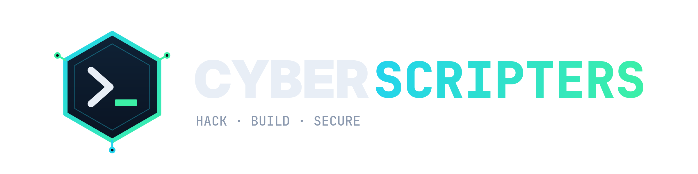

<p align="center">
  
</p>

<h1 align="center">Build a Secure RAG From Scratch</h1>

<p align="center">
  Code for the <b>CyberScripters</b> YouTube series. We build a RAG (Retrieval Augmented Generation)
  system that answers questions from <b>PDFs, Word documents, emails and Slack</b>, then we
  <b>attack it</b> and <b>secure it</b>.
</p>

---

## What you'll build

A "company knowledge assistant" for a fictional company, **Acme Robotics**:

- Ingests PDFs (including scanned ones), DOCX files, email threads and Slack exports
- Retrieves the right chunks with embeddings, hybrid search and re-ranking
- Answers with **citations** to the exact source
- Runs **100% locally with Ollama**, or with **OpenAI** or **Claude** by changing one setting
- Gets evaluated with real metrics, then hardened against prompt injection and data leaks

## Episodes

Each episode has a folder and a git **branch** (`ep01`, `ep02`, …), so you can check out the code exactly as it was at the end of any episode:

```bash
git checkout ep02
```

| # | Episode | Folder | Status |
|---|---------|--------|--------|
| 01 | What is RAG and why it matters | [`ep01/`](ep01) | ✅ |
| 02 | Your first RAG in under 50 lines | [`ep02/`](ep02) | ✅ |
| 03 | Embeddings & vector databases | [`ep03/`](ep03) | ✅ |
| 04 | PDFs done right (incl. scanned PDFs) | [`ep04/`](ep04) | ✅ |
| 05 | Word documents & metadata | `ep05/` | 🔜 |
| 06 | Emails | `ep06/` | 🔜 |
| 07 | Slack | `ep07/` | 🔜 |
| 08 | One ingestion pipeline for everything | `ep08/` | 🔜 |
| 09 | Better retrieval: hybrid search & re-ranking | `ep09/` | 🔜 |
| 10 | Chat UI with citations | `ep10/` | 🔜 |
| 11 | Evaluating your RAG | `ep11/` | 🔜 |
| 12 | Hacking & securing your RAG | `ep12/` | 🔜 |

## Sample data

[`data/acme/`](data/acme) contains documents for **Acme Robotics**, a fictional company. All names, policies and numbers are made up. The handbook PDF is generated by [`tools/make_handbook.py`](tools/make_handbook.py).

## Requirements

- Python **3.11+**
- [Ollama](https://ollama.com) installed, with these models:
  ```bash
  ollama pull llama3.2
  ollama pull mxbai-embed-large   # default embedding model from EP03
  ollama pull nomic-embed-text    # used in EP02
  ```
- ~8 GB RAM
- From EP04: [Tesseract OCR](https://github.com/tesseract-ocr/tesseract) (`apt install tesseract-ocr` / `brew install tesseract`)
- Optional: an OpenAI or Anthropic API key, if you want to use a cloud model instead

## Choosing the model

Copy `.env.example` to `.env` and pick a provider:

```bash
LLM_PROVIDER=ollama      # ollama | openai | anthropic
```

See [`ep02/llm.py`](ep02/llm.py) for the same `generate()` function implemented three ways. Embeddings always run locally with Ollama.

## Security note

Episode 12 demonstrates prompt-injection and data-leak attacks **against our own demo system**, using fictional data. Use these techniques only on systems you own or are authorised to test.

## License

[MIT](LICENSE) © CyberScripters
